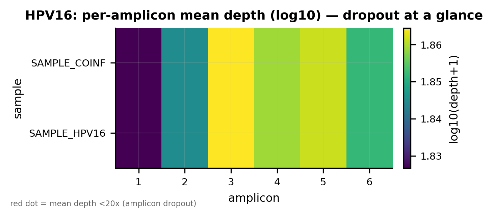
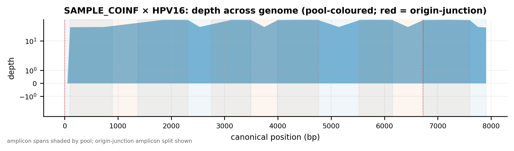
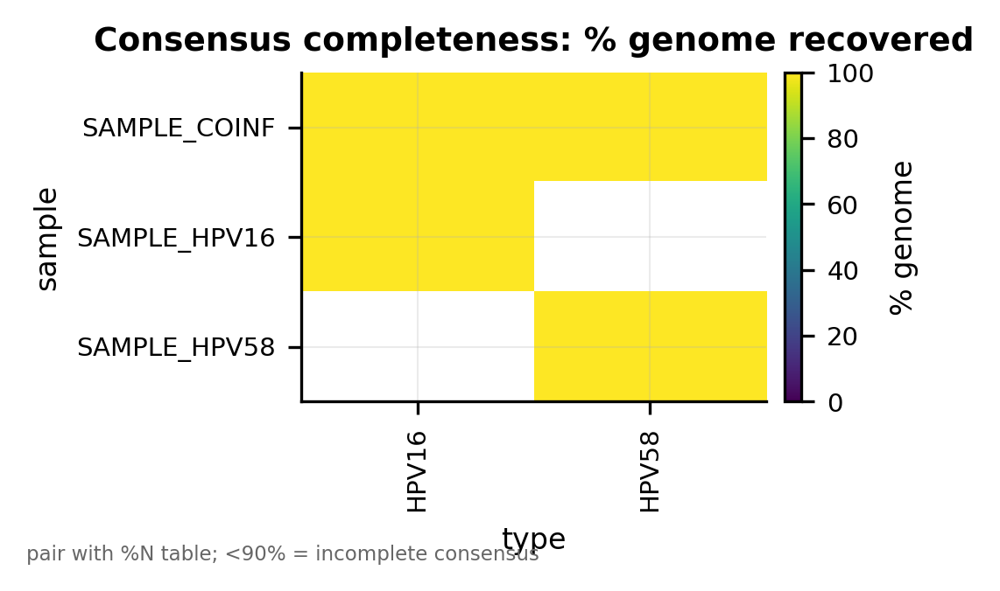
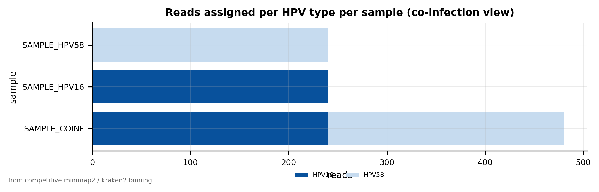

# Document control {-}

| Field | Value |
|-------|-------|
| Document | HPV Whole-Genome Nanopore Analysis Pipeline — Report & User Manual |
| Manual version | **v1.1** (final; deployed-shared-install reality) |
| Date | **2026-06-06** |
| Scheme version | Primer scheme **v5** (canonical accessions; 12 high-risk HPV types) |
| Shared install root | `INSTALL_ROOT=/hpc/opt/hpv-bioinfo` |
| Shared conda home | `HPV_CONDA_HOME=/hpc/opt/conda` (named `hpv-*` envs) |
| Deployed pipeline | `HPV_PIPELINE=/hpc/opt/hpv-bioinfo/pipeline` (run via `hpv-run`) |
| Validation (callers) | `artic+clair3`, Clair3 model `r1041_e82_400bps_hac_g615` |
| Validation (deployment) | `verify_env.sh` under a non-admin account: **53 passed, 0 failed** |

> **How this document was produced — read this first.** Every fact here was pulled from the
> live system or actual run outputs, never from memory:
>
> - **Tool versions** are the actual installed builds, read from a live `conda list` of all
>   six shared envs (`/hpc/opt/conda/envs/hpv-{qc,artic,asm,py,typing,smk}`), captured on the
>   production cluster and shipped beside this manual as **`hpv_env_versions.txt`**. Runtime
>   `--version` banners (e.g. `minimap2 2.31-r1302`, `nextflow 26.04.3`) are quoted where they
>   differ from the conda package string.
> - **Validation evidence** (engine, model, %genome, seam N, co-infection, and the non-admin
>   `verify_env.sh` result) is quoted from the actual run outputs.

# Scope

This document is both a **reference report** (what the pipeline is, how it is built, and how
it was validated) and a **practical user manual** (how any lab member runs it on real
sequencing data). It covers the HPV **whole-genome tiling-amplicon** Nanopore analysis system
for **12 high-risk HPV types** — **HPV 16, 18, 31, 33, 35, 39, 45, 52, 56, 58, 59, 66** —
using a lineage-robust primer scheme (**v5**) designed for sub-Saharan African genomic
diversity. Each type is amplified as a **6-amplicon, dual-pool** tiling set spanning the full
~7.8–7.9 kb circular genome, including the **origin-spanning junction amplicon**. The platform
is **CPU-only** and runs on the shared HPC cluster; basecalling and demultiplexing happen
upstream on the instruments (GridION / PromethION P2 Solo). The pipeline takes demultiplexed
`fastq_pass/barcodeNN/` reads and produces per-type whole-genome consensus sequences, variant
calls, coverage QC, and publication-quality figures.

Audience: all lab users on the cluster who run analyses, plus a methods-section reader who
needs the provenance and validation record.

# Executive summary

The system performs **end-to-end HPV whole-genome reconstruction from Nanopore
tiling-amplicon reads**:

1. **Ingest** demultiplexed `fastq_pass/barcodeNN/` reads per sample.
2. **Read QC** (length/quality stats; optional pycoQC run report from `sequencing_summary`).
3. **Amplicon-aware length filter** (retains the short ~1.1 kb HPV52 L1 gap-fill amplicon
   while removing chimeras / short fragments).
4. **Type assignment (binning)** by competitive minimap2 mapping against all 12 references —
   **co-infection-aware** (a sample can resolve to more than one type).
5. **Per-type consensus** via the real **ARTIC `minion` + Clair3** path, including the
   **two-run origin-junction handling** that recovers the seam.
6. **Coverage QC** (per-amplicon depth, pool balance, completeness).
7. **Summary tables + publication figures**.

Key properties:

- **CPU-only.** No GPU and no basecaller on the cluster — Clair3 and everything else run on
  CPU. Basecalling happens on the **GridION** and **PromethION P2 Solo** (both R10.4.1,
  400 bps chemistry).
- **Shared, all-users deployment.** Named `hpv-*` conda envs live in the shared cluster conda
  (`/hpc/opt/conda/envs`); reference data, models, schemes **and the pipeline code itself**
  live on the shared pool (`/hpc/opt/hpv-bioinfo`; code at `$HPV_PIPELINE`, run via `hpv-run`).
  The login profile auto-loads variables and PATH silently, so **a non-admin user needs no
  setup, no GitHub clone, and nothing in their home directory to run the pipeline.** All
  run-time output goes to the user's own working directory; nothing is written to the shared
  install.
- **Validated two ways (see the Validation record).** (1) End-to-end on the real
  **ARTIC 1.10.1 + Clair3 2.0.1** path (engine `artic+clair3`, 100 % genome, 0 % N, seam
  N = 0, co-infection split). (2) The all-users deployment verified by `verify_env.sh` under a
  genuine **non-admin** account: **53 passed, 0 failed**.

> **Software validation vs biological validation.** Both proofs are *software* validations —
> they show the pipeline runs end to end and deploys correctly for all users. **Biological
> validation on control material (characterised isolates / clinical positives) is the next,
> separate, wet-lab step.**

# System architecture

## Shared-pool layout (all-users model)

Two shared locations, both on `/hpc` so every node sees them identically:

| Component | Location | Notes |
|-----------|----------|-------|
| Named conda envs | `/hpc/opt/conda/envs/hpv-{qc,artic,asm,py,typing,smk}` | Created like the lab's `wgs_*` envs; resolve cluster-wide by name |
| Shared data/tools | `INSTALL_ROOT=/hpc/opt/hpv-bioinfo` | Owned `root:bioinfo`, dirs `2775` setgid, files world-readable |
| Primer schemes | `$SCHEME_DIR` = `…/primer-schemes/HPV*/V5/` | `reference.fasta`, `primer.bed`, insert/amplicon BEDs |
| References | `$REF_DIR` = `…/references/hpv_all_types.fasta` | `+ .fai`, `+ .mmi` minimap2 index |
| Clair3 models | `$MODELS_DIR` = `…/clair3_models/` | r10.4.1 400 bps **fast / hac / sup** (read-only) |
| Binaries | `…/bin` | On `PATH`; holds `nextflow` and the `hpv-run` launcher |
| **Pipeline code** | `$HPV_PIPELINE` = `…/pipeline` | Deployed `run_pipeline.py`, `hpvpipe.py`, `qc_report.py`, `qc_lib.py`, `simulate_test_data.py`, `Snakefile`, `main.nf`, `nextflow.config`, `testdata/` — the copy **all users run** |
| Manual / docs | `…/docs` | This manual (`.md`/`.pdf`/`.docx`) + figures |
| Profile | `/etc/profile.d/hpv-bioinfo.sh` | Auto-loads `SCHEME_DIR`, `REF_DIR`, `MODELS_DIR`, `HPV_PIPELINE`, `HPV_ARTIC_RUN`; provides `hpv-activate`, `hpv-run` |
| Logs / scheme summary | `…/logs/` ; `scheme_summary.tsv` | Install logs + per-type scheme provenance |

**The all-users rule (HARD):** the shared install is read/execute for everyone, write for
admins only. No analysis step writes to `/hpc/opt/hpv-bioinfo` or the shared conda. All
outputs, caches, work and temp go to the user's CWD/HOME — the profile points `NXF_HOME`,
`APPTAINER_CACHEDIR` and `CONDA_PKGS_DIRS` into `$HOME`, and Clair3 models are read-only
(passed by path, never written back).

## Stage-flow diagram

```text
Instrument (GridION / PromethION P2 Solo): basecalling + demultiplexing
   |
   v   fastq_pass/barcodeNN/*.fastq.gz  (+ sequencing_summary_*.txt)
   |
 [1] INGEST         concat per-barcode FASTQ -> per-sample        (hpv-py)
 [2] READ QC        length/quality stats (+pycoQC if seq-summary) (hpv-qc)
 [3] LENGTH FILTER  amplicon-aware window (keeps HPV52 ~1.1 kb)   (hpv-qc)
 [4] TYPE ASSIGN    competitive minimap2 vs 12 refs; co-infection (hpv-py)
 [5] CONSENSUS      ARTIC minion + Clair3                       (hpv-artic)
       main:     5 non-wrapping amplicons on the canonical ref
       junction: amp3 on a ROTATED ref -> rotate back + merge seam
 [6] COVERAGE QC    per-amplicon depth, pool balance            (hpv-py)
 [7] SUMMARY+FIGS   run_summary / consensus_qc / junction_proof (hpv-py)
   |
   v
 results/ : consensus FASTA, VCF, coverage, figures, summary -> USER WORKDIR
```

The same graph is implemented three ways with identical stages: `run_pipeline.py`
(single-driver, recommended), `Snakefile` (Snakemake), and `main.nf` (Nextflow). The core
stage logic lives in `pipeline/hpvpipe.py`.

# The six conda environments

All six are **named envs in the shared cluster conda** and activate cluster-wide:

```bash
conda activate hpv-qc        # exactly like: conda activate wgs_prokka
# or, equivalently:
hpv-activate qc
```

> **Version tables carry the actual installed builds.** Each shows the spec **floor** (`>=`
> pin from `server-setup/envs/<env>.yml`) and the **installed (live)** build read from
> `conda list` on the cluster (full capture in `hpv_env_versions.txt`). The Python interpreter
> version is in each heading. Re-confirm on the node with `conda list -n hpv-<name>` or
> `conda run -n hpv-<name> <tool> --version`.

## hpv-qc — read QC, filtering, coverage (Python 3.13.13)

**Purpose:** read-level QC, length/quality filtering, coverage, generic utilities. **Use it
for:** read QC and the length filter, plus ad-hoc `seqkit`/`samtools`/`mosdepth` inspection.

| Tool | Floor | Installed (live) |
|------|-------|------------------|
| python | 3.10 | 3.13.13 |
| nanoplot | 1.42 | 1.46.2 |
| nanocomp | 1.23 | 1.25.6 |
| pycoqc | 2.5 | 2.5.0.3 |
| multiqc | 1.21 | 1.35 |
| fastqc | 0.12 | 0.12.1 |
| seqkit | 2.6 | 2.13.0 |
| csvtk | 0.30 | 0.37.0 |
| mosdepth | 0.3.8 | 0.3.14 |
| bedtools | 2.31 | 2.31.1 |
| samtools | 1.19 | 1.23.1 |
| chopper | 0.7 | 0.13.0 |
| htslib · tabix · pigz | — | 1.23.1 · 1.11 · 2.8 |

```bash
hpv-activate qc
NanoPlot --fastq fastq_pass/barcode01/*.fastq.gz -o qc/barcode01 --N50
pycoQC -f sequencing_summary_*.txt -o qc/pycoQC.html   # needs the seq summary
seqkit stats -a fastq_pass/barcode01/*.fastq.gz
```

## hpv-artic — ARTIC consensus + Clair3, CPU (Python 3.11.15)

**Purpose:** the core variant-calling / consensus environment — **ARTIC fieldbioinformatics**
with **Clair3 2.x** (PyTorch models), CPU-only. **Use it for:** per-type consensus. The
pipeline shells into this env via `HPV_ARTIC_RUN="conda run -n hpv-artic"`.

| Tool | Floor | Installed (live) |
|------|-------|------------------|
| python | 3.9 | 3.11.15 |
| artic (fieldbioinformatics) | 1.6 | **1.10.1** (engine of record) |
| clair3 | 2.0.1 | **2.0.1** |
| pytorch-cpu (Clair3 backend) | — | **2.10.0** (`cpu_generic` — confirms CPU-only) |
| align_trim | 1.1.0 | 1.1.0 |
| primalbedtools | 1.0.0 | 1.0.0 |
| minimap2 | 2.26 | 2.31 (runtime `2.31-r1302`) |
| samtools | 1.19 | 1.23.1 |
| bcftools | 1.19 | 1.23.1 |
| htslib | 1.19 | 1.23.1 |
| seqtk · biopython · pyfaidx · tabix | — | 1.5 · 1.87 · 0.9.0.4 · 1.11 |

*Also present:* `whatshap` 2.8, `longphase` 2.0.2 (phasing), `bwa` 0.7.19, `mafft` 7.526,
`pysam` 0.24.0.

> The ARTIC `minion.log.txt` from the validation run confirms the live tool chain:
> `minimap2 -a -x map-ont`; `align_trim --normalise 100 … --primer-match-threshold 35
> --min-mapq 20`; and `run_clair3.sh … --platform=ont
> --model_path=…/r1041_e82_400bps_hac_g615`.

```bash
hpv-activate artic
artic --version
# ARTIC offline scheme loading uses the local files directly (no manifest fetch):
artic minion --threads 16 \
  --bed "$SCHEME_DIR/HPV16/V5/HPV16.primer.bed" \
  --ref "$SCHEME_DIR/HPV16/V5/HPV16.reference.fasta" \
  --model-dir "$MODELS_DIR" \
  SAMPLE_X.HPV16     # the pipeline orchestrates this — see Origin-junction handling
```

## hpv-asm — optional de novo path (Python 3.12.13)

**Purpose:** optional de novo assembly / polishing for divergent, novel, or hard co-infection
cases. **`medaka` here is the standalone polisher only — NOT the ARTIC variant caller**
(variant calling is Clair3 in `hpv-artic`).

| Tool | Floor | Installed (live) |
|------|-------|------------------|
| python | 3.9 | 3.12.13 |
| flye | 2.9.3 | 2.9.6 |
| medaka | 1.11 | **2.2.2** |
| racon | 1.5 | 1.5.0 |
| minimap2 | 2.26 | 2.31 (runtime `2.31-r1302`) |
| samtools | 1.19 | 1.23.1 |
| bcftools | — | 1.23.1 |
| any2fasta | — | 0.8.1 |
| pytorch-cpu (medaka backend) | — | 2.9.1 (`cpu_mkl`) |

```bash
hpv-activate asm
flye --nano-hq typing/SAMPLE_X.HPV16.fastq.gz \
  --out-dir asm/SAMPLE_X.HPV16 --threads 16
medaka_consensus -i typing/SAMPLE_X.HPV16.fastq.gz \
  -d draft.fasta -o medaka_out -t 16
```

## hpv-py — typing/binning, summaries, figures (Python 3.13.13)

**Purpose:** the Python analysis environment — type assignment (binning), summary tables, and
**publication QC figures**. **Use it for:** ingest, binning, coverage QC, figures, and to drive
the whole pipeline (`run_pipeline.py` / `qc_report.py`).

| Tool | Floor | Installed (live) |
|------|-------|------------------|
| python | 3.10 | 3.13.13 |
| pysam | 0.22 | 0.24.0 |
| biopython | 1.83 | 1.87 |
| pandas | 2.1 | 3.0.3 |
| numpy | 1.26 | 2.4.6 |
| scipy | 1.11 | 1.17.1 |
| pyfaidx | 0.7 | 0.9.0.4 |
| scikit-bio | 0.5.9 | 0.7.3 |
| matplotlib | 3.8 | 3.10.9 |
| seaborn | 0.13 | 0.13.2 |
| plotly | 5.20 | 6.8.0 |
| python-kaleido | 0.2.1 | 1.3.0 |
| minimap2 | 2.26 | 2.31 (runtime `2.31-r1302`) |
| samtools | 1.19 | 1.23.1 |
| mosdepth | 0.3.8 | 0.3.14 |
| bedtools | 2.31 | 2.31.1 |
| fonttools | — | 4.63.0 |

*Also present:* `statsmodels` 0.14.6.

```bash
hpv-activate py
hpv-run --help    # == python "$HPV_PIPELINE/run_pipeline.py" --help
                  # hpv-run runs the orchestrator in THIS env (hpv-py) and calls other
                  # envs per-stage via conda run — see "Running a real analysis".
# regenerate figures from an existing results/ dir:
PYTHONPATH="$HPV_PIPELINE" \
  python "$HPV_PIPELINE/qc_report.py" \
  --results results --scheme-dir "$SCHEME_DIR"
# prove the figure module on synthetic demo data:
PYTHONPATH="$HPV_PIPELINE" \
  python "$HPV_PIPELINE/qc_report.py" --demo --outdir /tmp/demo/figures
```

## hpv-typing — optional k-mer / competitive read typing (Python 3.14.5)

**Purpose:** optional k-mer / competitive-mapping read typing against a custom 12-type HPV
database, plus BLAST / Entrez utilities for ad-hoc lookup. **Use it for:** an independent
typing cross-check (the primary binning runs in `hpv-py`).

| Tool | Floor | Installed (live) |
|------|-------|------------------|
| python | 3.10 | 3.14.5 |
| minimap2 | 2.26 | 2.31 (runtime `2.31-r1302`) |
| samtools | 1.19 | 1.23.1 |
| pysam | 0.22 | 0.24.0 |
| kraken2 | 2.1.3 | 2.17.1 |
| seqkit | 2.6 | 2.13.0 |
| blast | — | 2.17.0 |
| entrez-direct | — | 24.0 |

```bash
hpv-activate typing
minimap2 -x map-ont -a "$REF_DIR/hpv_all_types.fasta" reads.fastq.gz \
  | samtools sort -o aln.bam
# kraken2 needs a custom 12-type HPV DB built separately by an admin
```

## hpv-smk — Snakemake workflow manager (Python 3.13.13)

**Purpose:** the Snakemake workflow engine (alternative to the Nextflow binary on PATH).

| Tool | Floor | Installed (live) |
|------|-------|------------------|
| python | 3.10 | 3.13.13 |
| snakemake-minimal | 8.10 | **9.22.0** |
| pandas | 2.1 | 3.0.3 |

> The installed Snakemake is the **9.x** series (floor was 8.10). The example commands use
> options stable across 8/9.

# The analysis pipeline in detail

Each stage lists what it does, the env/tool, inputs/outputs, and key parameters. Defaults are
read from `run_pipeline.py` / `hpvpipe.py`.

## Stage 1 — Ingest
- **Env/tool:** `hpv-py` (pure Python / gzip).
- **In:** `fastq_pass/<barcode>/*.fastq{,.gz}` per the sample sheet. **Out:**
  `results/reads/<sample>.fastq.gz` (one concatenated FASTQ per sample).
- Maps each `barcodeNN` to its `sample_id` from `sample_sheet.csv`.

## Stage 2 — Read QC
- **Env/tool:** `hpv-qc` (NanoPlot/pycoQC); the driver also writes per-read length tables.
- **In:** per-sample reads (+ optional `sequencing_summary_*.txt`). **Out:**
  `results/qc/read_stats.tsv`, `results/qc/lengths/<sample>.lengths.tsv`, and a **pycoQC** run
  report *only if* the `sequencing_summary` was uploaded.

## Stage 3 — Amplicon-aware length filter
- **Env/tool:** `hpv-qc` (`chopper` if present; else a built-in AWK/Python filter).
- **In:** per-sample reads. **Out:** `results/filtered/<sample>.filt.fastq.gz`.
- **Key parameters:** `--min-len 900` (default), `--max-len 4800` (default), quality `-q 9`.

> **Caveat — the length window must keep HPV52 amp7.** The HPV52 L1 gap-fill amplicon
> (**amp7, ~1117 bp**) is *shorter* than the 2–4 kb tiling amplicons. The minimum length must
> stay **≥ ~900 bp** or this amplicon is filtered out and HPV52 loses L1 coverage.

## Stage 4 — Type assignment (binning)
- **Env/tool:** `hpv-py` — competitive `minimap2` mapping (`hpvpipe.py bin`).
- **In:** filtered reads + `references/hpv_all_types.fasta`. **Out:**
  `results/typing/<sample>.types.tsv`, per-type `results/typing/<sample>.<TYPE>.fastq.gz`, and
  `results/typing/type_counts.tsv`.
- **Key parameters:** `--min-reads 20` (default; a type must reach this read count to be
  "present"), `--min-ident 0.80` (default minimum identity for read assignment), `--threads`.
- **Co-infection handling:** each read is assigned to its best-scoring type; **a sample can
  yield multiple present types** (e.g. the validated HPV16/HPV58 co-infection). Every present
  type is carried independently through consensus.

## Stage 5 — Per-type consensus (ARTIC + Clair3, with junction handling)
- **Env/tool:** `hpv-artic` (ARTIC `minion` -> `align_trim` -> Clair3), orchestrated by
  `hpvpipe.py consensus`; the portable pysam pileup engine is an explicit opt-in fallback.
- **In:** per-type reads + per-type scheme (`primer.bed`, `reference.fasta`) + Clair3 models.
  **Out:** `results/consensus/<sample>.<TYPE>.consensus.fasta`, VCFs, per-amplicon depth
  tables, `…consensus_qc.tsv`, `…junction_proof.tsv`.
- **Key parameters:** `--use-artic` (real ARTIC+Clair3 path), `--require-artic` (strict: abort
  on any failure), `--allow-fallback` (opt in to the portable engine), `--mindepth 3` (default;
  positions below become `N`), `--model`/`--model-dir` (Clair3 model — see Clair3 model
  selection). ARTIC internally runs `align_trim --normalise 100 --primer-match-threshold 35
  --min-mapq 20`.
- The **dual-pool** design (Pool 1 / Pool 2 alternating amplicons) is honoured by ARTIC's
  read-group handling; the origin-junction two-run mechanism is detailed in the next section.

## Stages 6–7 — Coverage QC, summary & figures
- **Env/tool:** `hpv-py` (`qc_report.py`, mosdepth-style per-base/amplicon coverage).
- **Out:** `results/coverage/*`, `results/run_summary.tsv`,
  `results/consensus/consensus_qc.tsv`, and `results/figures/` (every figure as **SVG + PDF +
  300-dpi PNG**, colour-blind-safe, embedded fonts). See Interpreting outputs.

# Origin-junction handling

This is the system's most distinctive feature.

## Why there is a seam
HPV genomes are **circular**, but reference FASTAs and ARTIC are **linear**. To tile the whole
genome the scheme must place **one amplicon that spans the origin** (position 0) — this is
**amp3** in every type (`scheme_summary.tsv`: `junction_amplicon = 3`,
`junction_wraps_origin = YES` for all 12 types). On a linear reference, that amplicon's right
primer coordinate is *smaller* than its left (it wraps past the end back to the start). For
HPV16, `rotation.json` records amp3 as canonical **LEFT = [6722, 6744], RIGHT = [874, 896]**
on a genome of length **L = 7906** — i.e. it runs from ~6722 across the origin to ~896.

ARTIC's `align_trim` computes each amplicon's length as `right_end − left_start`. For a
wrapping amplicon that is **negative**, and `align_trim` then attempts `np.zeros(length)` —
historically this crashed with *"ValueError: negative dimensions are not allowed."* The seam
must therefore be handled explicitly, or amp3 (and the region across the origin) is lost.

## Why a single rotated frame is not enough
The intuitive fix — rotate the reference so the origin moves to the middle and amp3 becomes
contiguous — works **for amp3**, but it just **moves the wrap to whichever amplicon now spans
the new origin**. A single rotated frame always leaves *some* amplicon wrapping. There is no
single linear frame in which all six amplicons of a circular tiling scheme are simultaneously
non-wrapping.

## The implemented two-run solution
The pipeline runs ARTIC **twice, each on a frame where every amplicon it sees is
positive-length**, then merges:

1. **Main run — canonical reference, amp3 removed.** ARTIC is given a primer BED with the
   junction amplicon excluded (`<sample>.<TYPE>.no_amp3.primer.bed`), so `align_trim` only ever
   sees the **5 non-wrapping amplicons**. These are mapped, primer-trimmed, and called by
   Clair3 normally. The origin seam is left as `N` in this consensus.
2. **Junction run — rotated reference, amp3 only.** A per-type **rotated reference** is built
   (`rotate-build`): the origin is shifted by an offset (~L/2) so amp3 becomes one
   **contiguous, positive-length** amplicon. For HPV16, `rotation.json` shows amp3 rotated to
   **LEFT = [2769, 2791], RIGHT = [4827, 4849]** (offset **3953**) — clearly positive. ARTIC +
   Clair3 call amp3 on this frame.
3. **Rotate back & merge.** The amp3 consensus is mapped back to canonical coordinates
   (`pos_canon = (pos_rot + offset) mod L`) and used to **fill only the seam positions still
   `N`** in the main consensus. Length is unchanged; no double-counting.

Both runs go through the real `align_trim` + Clair3, and **neither run ever passes a
negative-length amplicon** to `align_trim`. The validation-run logs show exactly this: the main
run calls `align_trim … <sample>.no_amp3.primer.bed`, and the junction run (`*.artic.rotj`)
calls `align_trim … HPV16.rot.primer.bed` on `HPV16.rot.reference.fasta`.

## Evidence it recovers the seam (`junction_proof.tsv`)
The per-(sample×type) `junction_proof.tsv` records the merge. From the validation run:

| metric | HPV16 (SAMPLE_COINF) | HPV58 (SAMPLE_COINF) |
|--------|----------------------|----------------------|
| junction_amplicon | amp3 | amp3 |
| junction_engine | artic+clair3 | artic+clair3 |
| rotation_offset | 3953 | 3912 |
| seam_region_bp | 2036 | 2208 |
| canonical_only_seam_N | 448 | 588 |
| **merged_seam_N** | **0** | **0** |
| seam_bases_filled_from_rotated | 448 | 588 |
| seam_identity_to_reference_pct | 100.0 | 100.0 |
| continuous_across_origin | YES | YES |
| length_unchanged | YES | YES |

The canonical-only consensus would have left **448 (HPV16) / 588 (HPV58)** `N` bases across the
origin; after the rotated amp3 run and merge, **merged seam N = 0** at **100 % identity to
reference**, continuous across the origin, length unchanged.

# Clair3 model selection

## Installed models
`$MODELS_DIR` (= `/hpc/opt/hpv-bioinfo/clair3_models/`) holds the full R10.4.1 **400 bps**
Clair3 2.x set — **fast / hac / sup** — because the lab runs both a GridION and a PromethION P2
Solo and the Dorado preset can differ per run. The `hac` build used in validation is
`r1041_e82_400bps_hac_g615`; all three tiers are installed (the setup step fails loudly if any
of fast/hac/sup is missing). List them on the node with `ls "$MODELS_DIR"`.

> **Clair3 runs on CPU.** In `hpv-artic`, Clair3 2.0.1 is backed by **`pytorch-cpu` 2.10.0**
> (`cpu_generic`) — no CUDA/GPU build is installed. Inference uses the PyTorch (`.pt`) models
> under `$MODELS_DIR`.

## Auto-selection and override
- **Auto:** the pipeline reads the FASTQ header `basecall_model_version_id` and selects the
  matching installed model by chemistry/speed/tier; it warns and uses the nearest installed
  model if an exact match is absent.
- **Override:** force a model explicitly with `--model <name> --model-dir "$MODELS_DIR"`.

```bash
# inspect what model selection would pick for a given FASTQ:
python "$HPV_PIPELINE/hpvpipe.py" model-select \
  --reads results/typing/SAMPLE_X.HPV16.fastq.gz \
  --models-dir "$MODELS_DIR"

# GridION header  …_400bps_hac@v5.2.0  -> selects r1041_e82_400bps_hac_*
# P2-Solo header  …_400bps_sup@v5.0.0  -> selects r1041_e82_400bps_sup_*
# force a tier if needed (passed through to hpvpipe consensus):
#   --model r1041_e82_400bps_sup_g615 --model-dir "$MODELS_DIR"
```

# Running a real analysis

> **How `hpv-run` uses the six environments — it does *not* activate them all.** `hpv-run`
> launches the orchestrator (`run_pipeline.py`) inside **one** environment, **`hpv-py`**, via
> `conda run -n hpv-py`. You never manually activate anything. The pipeline's own logic
> (ingest, binning, coverage QC, figures) is Python and runs in `hpv-py`. A stage that needs a
> *different* environment is invoked as a **subprocess** via `conda run -n <env>` — it is never
> activated in your shell. Specifically, the consensus stage calls **`hpv-artic`** through
> `HPV_ARTIC_RUN="conda run -n hpv-artic …"` to run `artic minion` + Clair3. Think of `hpv-py`
> as the conductor: it calls another env per-stage for its specific tools and then exits it, so
> **only `hpv-py` is ever active in the session.** The six envs are deliberately isolated
> (their tool/dependency versions would conflict if merged), so per-stage `conda run` is the
> correct way to compose them — not simultaneous activation.

Which environment runs what (default `run_pipeline.py` path):

| Stage(s) | Environment | How it is invoked |
|----------|-------------|-------------------|
| Orchestration, ingest, binning, coverage QC, figures (and the portable consensus engine when `--use-artic` is off) | `hpv-py` | the home env (`conda run -n hpv-py`) — what `hpv-run` starts |
| Consensus: `artic minion` + Clair3 (with `--use-artic`) | `hpv-artic` | subprocess via `HPV_ARTIC_RUN="conda run -n hpv-artic …"` |

(The optional read-QC tools in `hpv-qc` and the optional de novo path in `hpv-asm` are called
the same way — `conda run -n <env>` — when you use them, but they are not part of the default
automated `run_pipeline.py` run.) The **Explicit equivalent** block below
(`conda activate hpv-py; python "$HPV_PIPELINE/run_pipeline.py" …`) *is* what `hpv-run` does
internally — `hpv-py` is the home env.

## Running as any user (zero setup)
The pipeline is **deployed on the shared pool** and the login profile **auto-loads** the
environment **silently** at login. So a brand-new non-admin user, on any node, just logs in and
runs — **no `source`, no GitHub clone, no `server-setup`, nothing in `$HOME`.** After login,
`SCHEME_DIR`, `REF_DIR`, `MODELS_DIR`, `HPV_PIPELINE` and `HPV_ARTIC_RUN` are already set and
`hpv-run` is already on `PATH`.

```bash
# log in, then go to your own working directory (outputs land here, never in /hpc/opt):
cd ~/my_run_2026-06

# simplest: one command, real ARTIC + Clair3 path (strict)
hpv-run \
  --fastq-pass  fastq_pass \
  --samplesheet sample_sheet.csv \
  --scheme-dir  "$SCHEME_DIR" \
  --ref         "$REF_DIR/hpv_all_types.fasta" \
  --models-dir  "$MODELS_DIR" \
  --outdir      results \
  --use-artic --require-artic
```

`hpv-run` runs `run_pipeline.py` inside the `hpv-py` env via `conda run` (no manual
activation), and sets `HPV_ARTIC_RUN` so `--use-artic` reaches `hpv-artic` (see the call-out
at the top of this chapter on how the environments are composed). Explicit equivalent — this
is exactly what `hpv-run` does internally:

```bash
conda activate hpv-py
python "$HPV_PIPELINE/run_pipeline.py" \
  --fastq-pass  fastq_pass \
  --samplesheet sample_sheet.csv \
  --scheme-dir  "$SCHEME_DIR" \
  --ref         "$REF_DIR/hpv_all_types.fasta" \
  --models-dir  "$MODELS_DIR" \
  --outdir      results \
  --threads     16 \
  --use-artic --require-artic
```

Flag notes: **`--use-artic`** turns on the ARTIC `minion` + Clair3 path; **`--require-artic`**
is strict (aborts non-zero on any failure — use it for any reportable result); replace it with
**`--allow-fallback`** to permit the portable engine for quick triage; length/typing
thresholds are tunable (`--min-len 900 --max-len 4800 --min-reads 20`).

**Threading on the 72-core node:** Clair3 is the bottleneck. Prefer moderate threads per job ×
several jobs in parallel over maxing one job. A good default is `--threads 16` with multiple
samples concurrent via Snakemake/Nextflow; keep total cores and RAM within budget.

## Distribution model (source vs deployed)
- **GitHub repo** — source of truth / version control (developers only).
- **`/hpc/opt/hpv-bioinfo/pipeline`** (`$HPV_PIPELINE`) — the deployed copy **everyone runs**,
  via `hpv-run` or `$HPV_PIPELINE/...`.
- **Updating** = an admin pulls new code and re-runs the deploy step of
  `setup_hpv_nanopore_env.sh`, which refreshes `$HPV_PIPELINE` in place. Ordinary users never
  touch `server-setup` or GitHub to run the pipeline, and have nothing to update on their side.

## Before you start — copy these off the instrument
1. The **demultiplexed `fastq_pass/`** folder (`barcodeNN/` subfolders of `*.fastq.gz`).
2. **`sequencing_summary_*.txt`** — needed for the pycoQC run-health plots (channel activity,
   yield-over-time, pore occupancy). Without it those panels are skipped (read-derived QC still
   works).
3. Keep **both Pool 1 and Pool 2** reads — the pool-balance figure needs both.

Input layout the pipeline expects:

```text
fastq_pass/
  barcode01/*.fastq.gz
  barcode02/*.fastq.gz
sequencing_summary_*.txt        # optional, enables pycoQC
sample_sheet.csv
```

## The sample sheet
`sample_sheet.csv` — header `barcode,sample_id,expected_types,notes`:

```csv
barcode,sample_id,expected_types,notes
barcode01,SAMPLE_001,,
barcode02,SAMPLE_002,HPV16;HPV58,suspected co-infection
```

`barcode` = the MinKNOW `barcodeNN` folder; `expected_types` is optional and `;`-separated.

## Equivalent: Snakemake
```bash
conda activate hpv-py
snakemake -s "$HPV_PIPELINE/Snakefile" -j4 \
  --config scheme_dir="$SCHEME_DIR" \
           ref="$REF_DIR/hpv_all_types.fasta" \
           models_dir="$MODELS_DIR" \
           fastq_pass=fastq_pass \
           samplesheet=sample_sheet.csv \
           use_artic=true threads=16
```

## Equivalent: Nextflow
```bash
nextflow run "$HPV_PIPELINE/main.nf" \
  --fastq_pass fastq_pass \
  --samplesheet sample_sheet.csv \
  --scheme_dir "$SCHEME_DIR" \
  --ref "$REF_DIR/hpv_all_types.fasta" \
  --models_dir "$MODELS_DIR" \
  --outdir results --use_artic
# tune CPU/RAM per process in nextflow.config
```

## SLURM / scheduler batch jobs
`/etc/profile.d/hpv-bioinfo.sh` auto-loads for interactive **login** shells, but batch /
non-login jobs do **not** read `/etc/profile.d`. A job script must load the environment
explicitly at the top:

```bash
#!/bin/bash
#SBATCH --job-name=hpv --cpus-per-task=16 --mem=32G
source /etc/profile.d/hpv-bioinfo.sh   # or: source /hpc/opt/hpv-bioinfo/etc/hpv-bioinfo.env
cd "$SLURM_SUBMIT_DIR"
hpv-run \
  --fastq-pass  fastq_pass \
  --samplesheet sample_sheet.csv \
  --scheme-dir  "$SCHEME_DIR" \
  --ref         "$REF_DIR/hpv_all_types.fasta" \
  --models-dir  "$MODELS_DIR" \
  --outdir      results \
  --threads     "$SLURM_CPUS_PER_TASK" \
  --use-artic --require-artic
```

## Where outputs land
Everything is written under your **`--outdir` (default `./results`) in your own working
directory** — never to `/hpc/opt`:

```text
results/
  reads/<sample>.fastq.gz                       # ingested per-sample reads
  qc/read_stats.tsv, qc/lengths/                # read QC
  filtered/<sample>.filt.fastq.gz               # length-filtered reads
  typing/<sample>.types.tsv                     # type calls (+ per-type FASTQ)
  consensus/<sample>.<TYPE>.consensus.fasta     # per-type whole-genome consensus
  consensus/<sample>.<TYPE>.*.vcf(.gz)          # Clair3 variant calls
  consensus/<sample>.<TYPE>.consensus_qc.tsv    # per-type QC row
  consensus/<sample>.<TYPE>.junction_proof.tsv  # seam recovery proof
  consensus/consensus_qc.tsv                    # aggregated QC
  coverage/                                     # per-amplicon / per-base depth
  figures/                                      # SVG + PDF + 300-dpi PNG
  run_summary.tsv                               # sample -> types present
```

# Interpreting outputs

## run_summary.tsv
One row per sample: `sample_id` and the `;`-separated `types_present`. From the validation run:

```text
sample_id      types_present
SAMPLE_HPV16   HPV16
SAMPLE_HPV58   HPV58
SAMPLE_COINF   HPV16;HPV58
```

## consensus_qc.tsv
One row per (sample × type):

| column | meaning |
|--------|---------|
| `sample_id`, `type` | the sample and HPV type |
| `pct_genome` | % of the reference reconstructed (non-N) |
| `pct_N` | % of the consensus that is `N` |
| `engine` | caller path used (`artic+clair3` or `portable`) |
| `model` | Clair3 model (e.g. `r1041_e82_400bps_hac_g615`) |
| `seam_N` | `N` bases across the origin **after** the junction merge |
| `junction_engine` | engine used for the amp3 junction run |
| `junction_bases_filled` | seam bases recovered from the rotated amp3 run |

## Consensus FASTAs / VCFs
- `…consensus.fasta` — the per-type whole-genome consensus (origin-continuous after merge).
- `…pass.vcf` / `…merged.vcf.gz` — Clair3 variant calls (per ARTIC read-group, then merged).

## The QC figures (`results/figures/`)
Each is emitted as SVG + PDF + 300-dpi PNG:

- **`03_amplicon_heatmap_<TYPE>`** — per-amplicon coverage heatmap (sample × amplicon,
  log-depth); the single most useful view (dropout shows as a cold cell).
- **`04_depth_<sample>_<TYPE>`** — per-base depth track (even tiling, seam continuity).
- **`01_read_counts_yield`** — reads/yield per sample.
- **`02_length_quality`** — length × quality (confirm the ~1.1 kb HPV52 amp survives).
- **`06_type_assignment`** — binning per sample (co-infections show as multiple bars).
- **`07_consensus_completeness`** — % genome / % N per sample×type.
- Pool-balance panel — Pool 1 vs Pool 2 representation (needs both pools).

{width=75%}

{width=75%}

{width=68%}

{width=68%}

## Design caveats analysts must expect
> - **HPV52 amp7 over-representation.** The short ~1.1 kb L1 gap-fill amplicon over-amplifies
>   in multiplex, so HPV52 depth is skewed toward amp7. Expected; the wet-lab mitigation is to
>   reduce HPV52_7 primer concentration or post-PCR normalise.
> - **HPV35 amp4 lower depth on divergent isolates.** HPV35 amp4 has a documented,
>   African-justified inclusivity exception (panel inclusivity 75 % from USA/divergent isolates;
>   African inclusivity 100 %). Expect lower amp4 depth on non-African divergent isolates — not
>   a pipeline fault.

# Validation record

Two independent software validations were performed. Both are software validations;
**biological validation on control material is the next, separate, wet-lab step.**

## (1) End-to-end on the real ARTIC + Clair3 path
A built-in synthetic dataset of three samples — `SAMPLE_HPV16`, `SAMPLE_HPV58`, and
`SAMPLE_COINF` (a deliberate HPV16 + HPV58 co-infection) — was run end to end through the real
ARTIC + Clair3 path (`--use-artic --require-artic`) on the cluster (16 threads). From the
actual `consensus_qc.tsv`:

\begingroup\scriptsize

| sample_id | type | pct_genome | pct_N | engine | model | seam_N | junction_engine | filled |
|:------------|:-----|------:|-----:|:---------|:-----------------|------:|:------------|------:|
| SAMPLE_HPV16 | HPV16 | 100.0 | 0.0 | artic+clair3 | r1041_e82_400bps_hac_g615 | 0 | artic+clair3 | 448 |
| SAMPLE_HPV58 | HPV58 | 100.0 | 0.0 | artic+clair3 | r1041_e82_400bps_hac_g615 | 0 | artic+clair3 | 588 |
| SAMPLE_COINF | HPV16 | 100.0 | 0.0 | artic+clair3 | r1041_e82_400bps_hac_g615 | 0 | artic+clair3 | 448 |
| SAMPLE_COINF | HPV58 | 100.0 | 0.0 | artic+clair3 | r1041_e82_400bps_hac_g615 | 0 | artic+clair3 | 588 |

\endgroup

Columns: `pct_genome` / `pct_N` = % genome reconstructed / % N; `seam_N` = origin `N` after
merge; `junction_engine` = caller for the amp3 run; `filled` = `junction_bases_filled`.

Evidence this is the real caller path (not the portable fallback): the ARTIC `minion.log.txt`
shows `align_trim --normalise 100 … --primer-match-threshold 35 --min-mapq 20` on the `no_amp3`
BED (main run) and the rotated BED (junction run), and `run_clair3.sh … --platform=ont
--model_path=…/r1041_e82_400bps_hac_g615` producing the per-amplicon VCFs.

Conclusions: all four sample×type combinations reconstruct **100 % of the genome, 0 % N**; the
origin seam is fully recovered (`merged_seam_N = 0` at 100 % identity, via the real
ARTIC+Clair3 two-run mechanism — see Origin-junction handling); and the co-infection is
correctly resolved (`SAMPLE_COINF -> HPV16;HPV58`, both reconstructed completely).

## (2) All-users deployment verified under a non-admin account
`verify_env.sh` was run by a genuine **non-admin** user on a node: **53 passed, 0 failed.**
It confirmed:

- **Named-env activation** — all six `hpv-*` envs resolve and activate by name
  (`conda activate hpv-<name>`), with clean tool-version rows.
- **Deployed pipeline end-to-end** — `simulate_test_data.py` + `run_pipeline.py` from
  `$HPV_PIPELINE` ran to completion, producing `run_summary.tsv`, the co-infection split,
  figures, and a valid sorted+indexed BAM (`samtools quickcheck` on a real `*.canonical.bam`).
- **No writes to the shared install** — the non-admin user could not write
  `/hpc/opt/hpv-bioinfo`, the shared conda, or `$HPV_PIPELINE`; all outputs landed in the
  user's own workdir/HOME.
- **Silent profile auto-load** — `/etc/profile.d/hpv-bioinfo.sh` sources with zero output, sets
  `HPV_PIPELINE` and puts `hpv-run` on PATH, runs no conda init, and does not duplicate PATH on
  re-source.
- **Clair3 2.x models** — fast/hac/sup present, readable, PyTorch (2.x) format.

# Troubleshooting & FAQ

**`CommandNotFoundError: … hpv-artic` / env not found.** Run `conda env list` — you should see
`hpv-qc … hpv-smk` next to `wgs_*`. If missing, the shared install isn't on this node's conda;
contact an admin. Never create the envs yourself.

**`hpv-run: command not found`.** Normally `hpv-run` is on PATH automatically at login. If you
are in a non-login/batch shell, `source /etc/profile.d/hpv-bioinfo.sh` first. Confirm with
`echo "$HPV_PIPELINE"` (-> `/hpc/opt/hpv-bioinfo/pipeline`) and `command -v hpv-run`. You never
need a home-directory copy; if `$HPV_PIPELINE` is missing entirely, the admin has not run the
deploy step.

**Clair3 "model not found".** `ls "$MODELS_DIR"` to see the installed
`r1041_e82_400bps_{fast,hac,sup}_*` builds. Pass an explicit `--model <name> --model-dir
"$MODELS_DIR"`. Confirm the FASTQ `basecall_model_version_id` matches an installed tier.

**`align_trim`: "negative dimensions are not allowed" (historical — fixed).** This was the
origin-junction amplicon (amp3) wrapping position 0 -> negative length. It is resolved by the
two-run design (see Origin-junction handling). If you see it again, you are pointing ARTIC at a
raw canonical BED that still contains amp3 — use the pipeline's consensus stage, which builds
the `no_amp3` and rotated BEDs for you.

**Low amplicon depth.** Check the `03_amplicon_heatmap` figure. Expected design hotspots: HPV52
amp7 (high) and HPV35 amp4 on divergent non-African isolates (low) — see Design caveats.
Otherwise suspect input depth or a pool imbalance (confirm both pools were included).

**Co-infection: only one type expected but two reported.** The binner is co-infection-aware by
design. Check `typing/<sample>.types.tsv` read counts; raise `--min-reads` if a low-count
second type is index-hopping noise rather than a true co-infection.

**A sample×type failed and the run aborted.** That is `--require-artic` doing its job (strict,
no silent fallback). Read `results/consensus/<sample>.<TYPE>.artic.main/*.minion.log.txt`. For
quick triage you may re-run with `--allow-fallback`, but **do not report fallback consensus as
ARTIC+Clair3 results**.

**Where do logs/outputs go?** Under your `--outdir` (default `./results`); per-stage ARTIC logs
in `results/consensus/<sample>.<TYPE>.artic.{main,rotj}/`. Nothing is written to `/hpc/opt`.

**Who do I contact for admin changes?** Anything touching `/hpc/opt/hpv-bioinfo` or the shared
conda (new models, scheme updates, env rebuilds, pipeline updates) is admin-only — file a
request with the bioinformatics core.

# Appendix

## Core runtime version strings
From each tool's own `--version` banner on the cluster (complements the conda-package versions
in the env tables): artic 1.10.1 · clair3 2.0.1 · minimap2 2.31-r1302 · samtools 1.23.1 ·
bcftools 1.23.1 · nextflow 26.04.3 · snakemake 9.22.0 · python 3.13.13.

## Full `conda list` per env
The complete package list for all six envs (every dependency, version, build string, channel)
is shipped beside this manual as **`hpv_env_versions.txt`**, captured live from the production
cluster. Headline summary:

| Env | Python | Headline installed versions |
|-----|--------|-----------------------------|
| `hpv-qc` | 3.13.13 | nanoplot 1.46.2 · nanocomp 1.25.6 · pycoqc 2.5.0.3 · multiqc 1.35 · fastqc 0.12.1 · seqkit 2.13.0 · csvtk 0.37.0 · mosdepth 0.3.14 · bedtools 2.31.1 · samtools 1.23.1 · chopper 0.13.0 |
| `hpv-artic` | 3.11.15 | **artic 1.10.1 · clair3 2.0.1** · pytorch-cpu 2.10.0 · align_trim 1.1.0 · primalbedtools 1.0.0 · minimap2 2.31 · samtools/bcftools/htslib 1.23.1 · whatshap 2.8 · longphase 2.0.2 |
| `hpv-asm` | 3.12.13 | flye 2.9.6 · **medaka 2.2.2** · racon 1.5.0 · minimap2 2.31 · samtools 1.23.1 · pytorch-cpu 2.9.1 · any2fasta 0.8.1 |
| `hpv-py` | 3.13.13 | pysam 0.24.0 · pandas 3.0.3 · numpy 2.4.6 · scipy 1.17.1 · scikit-bio 0.7.3 · matplotlib 3.10.9 · seaborn 0.13.2 · plotly 6.8.0 · kaleido 1.3.0 · minimap2 2.31 · mosdepth 0.3.14 |
| `hpv-typing` | 3.14.5 | minimap2 2.31 · samtools 1.23.1 · kraken2 2.17.1 · seqkit 2.13.0 · blast 2.17.0 · entrez-direct 24.0 |
| `hpv-smk` | 3.13.13 | **snakemake-minimal 9.22.0** · pandas 3.0.3 |
| `bin/` | — | nextflow 26.04.3 (runtime) + the `hpv-run` launcher |

Regenerate the capture on the node:

```bash
for e in hpv-qc hpv-artic hpv-asm hpv-py hpv-typing hpv-smk; do
  echo "=== $e ==="; conda list -n "$e"
done > hpv_env_versions.txt
```

The exact resolved builds are also exported at install time to
`/hpc/opt/hpv-bioinfo/envs_locks/<env>.lock.yml` (build strings in `.fullbuild.lock.yml`).

## The all-users permissions model
- Shared install `INSTALL_ROOT=/hpc/opt/hpv-bioinfo` owned `root:bioinfo`, dirs `2775`
  (setgid), files world-readable — read/execute for all users on any node.
- Named `hpv-*` envs in `/hpc/opt/conda/envs` (created like the lab's `wgs_*` envs).
- No analysis step writes to the shared install. Run-time output/cache/work/temp go to the
  user's CWD/HOME (`NXF_HOME`, `APPTAINER_CACHEDIR`, `CONDA_PKGS_DIRS` -> `$HOME`). Clair3 models
  are read-only, passed by `--model-dir`.
- Only admins modify the shared install; `setup_hpv_nanopore_env.sh` is idempotent and
  name-scoped (only ever creates/rebuilds `hpv-*`, never `base`/`wgs_*`).

## Design provenance
- **Scheme version v5**, 12 high-risk types, 6 amplicons each, dual-pool (Pool 1 / Pool 2), one
  origin-spanning junction amplicon (amp3) per type. Per-type clade, canonical accession, genome
  length, junction amplicon and degenerate-primer counts are in `scheme_summary.tsv` (e.g.
  HPV16/Alpha9/K02718/7906 bp; HPV58/Alpha9/D90400/7824 bp).
- Documented design exceptions: HPV35 amp4 African-justified inclusivity exception; HPV52 amp7
  ~1.1 kb L1 gap-fill over-amplification (`softsite_exceptions.md`, `wetlab_balancing_notes.md`).
- Full design methods & phylogeny: see the project METHODS_REPORT / `FINAL_REPORT_v1-v5`.

## How to report issues
Include: the exact command, the relevant
`results/consensus/<sample>.<TYPE>.artic.*/…minion.log.txt`, the `consensus_qc.tsv` /
`junction_proof.tsv` rows, and `conda list -n hpv-artic`. Send to the bioinformatics core. For
shared-install changes (models, schemes, envs, pipeline updates), file an admin request — do not
modify `/hpc/opt` yourself.

*End of document. Manual v1.1 · 2026-06-06 · generated from the live `conda list`
(`hpv_env_versions.txt`), the real ARTIC+Clair3 synthetic validation run, and the non-admin
`verify_env.sh` result (53 passed, 0 failed).*
